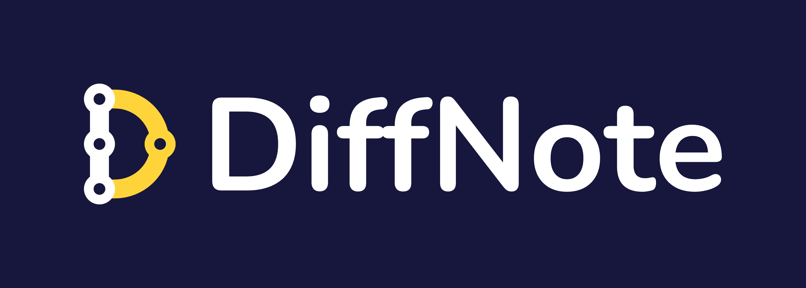
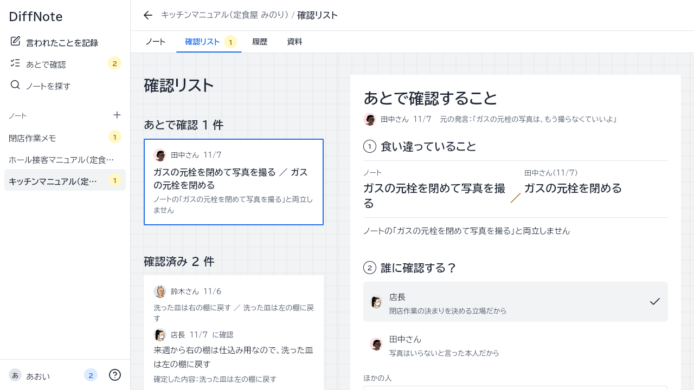
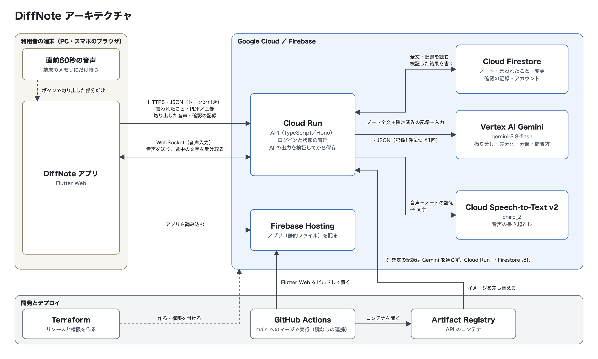

<div align="center">



# DiffNote（仮）

**教わったことを、ノートへの差分として残す。食い違いに気づいて、確かめられる。**


<a href="LICENSE"></a>

[デモ（ログインが必要）](https://diff-note-514023.web.app) ・ [できること](#できること) ・ [アーキテクチャ](#アーキテクチャ) ・ [ローカルで動かす](#ローカルで動かす) ・ [仕様](docs/spec/spec.md)



</div>

新人が、口頭で教わったことや自分で書いたことをノート（職場のマニュアルや自分用のメモ）への差分として記録し、食い違いに気づいて確認できる道具。仕様は [docs/spec/spec.md](docs/spec/spec.md)、開発のルールは [AGENTS.md](AGENTS.md)。

## できること

- **言われたことをそのまま入れる**：テキスト、音声入力、直前60秒をさかのぼる録音、PDF・画像から記録できる
- **ノートへの差分にする**：どのノートのどの行が変わるかを Gemini が案にし、誰がいつ言ったかと一緒に積む。本文は上書きしない
- **食い違いに気づく**：ノートや確定済みの記録と比べ、同じ内容・追記・条件付きの補足・矛盾に分ける
- **聞いて確かめる**：矛盾には確認する相手の候補と聞き方の例が出る。確かめた結果は「誰に・いつ・どう決まったか」としてノートに残る
- **一緒に使う**：ノートを共有し、教える側が確認に直接答えられる

## アーキテクチャ

<div align="center">

</div>

## リポジトリの構成

| ディレクトリ | 中身 |
|---|---|
| `app/` | Flutter クライアント（Web） |
| `api/` | Hono バックエンド |
| `infra/` | Terraform（Cloud Run・Firestore・Firebase Hosting・GitHub Actions 連携）。手順は [infra/README.md](infra/README.md) |
| `eval/` | 衝突検知の評価セットとスクリプト |
| `docs/` | 仕様（`spec/`）・ADR（`adr/`。一覧は [docs/adr/README.md](docs/adr/README.md)）・設計書（`design/`）・審査用のモック用データ案（`mock-data/`） |

## ブランチと公開

- 作業ブランチは `dev` から切り、`dev` に PR を出す（GitHub の既定ブランチは `dev`）
- `dev` は手元で動かして確かめる場所。デプロイはしない
- `dev` → `main` の PR をマージすると、GitHub Actions が本番（Cloud Run・Firebase Hosting）にデプロイする

## ローカルで動かす

必要なもの：Node.js 24 以上、pnpm、[FVM](https://fvm.app/)（Flutter のバージョンは `app/.fvmrc` で固定）、Chrome。

```sh
# API（偽の Gemini・メモリ上のデータで動く。GCP は不要）
cd api
pnpm install
pnpm dev            # http://localhost:8787

# アプリ（別のターミナルで）
cd app
fvm install
fvm flutter run -d chrome
```

アプリを開いたら、ID `demo`・パスワード `demo` でログインする。本番に配ったのと同じ ID（`kanade`・`haruto`・`hikaru`・`chinatsu`）でも入れるが、パスワードはどれもローカル専用の `demo`。どれもメモリ上のデータで動かすときだけ起動時に作り、見本のノートが入っているのは `demo` と `newbie` だけ。`demo` には、新人（ID `newbie`・パスワード `demo`）のノート「閉店作業メモ」が共有されていて、答える確認が2件待っている。`demo` で答えたあと `newbie` で入ると、通知で確かめられる（ADR 0017・0020）。

アプリが呼ぶ API の URL は `--dart-define=API_URL=...` で変えられる（既定は `http://localhost:8787`）。

偽の Gemini（`api/src/fake-ai.ts`）は、「田中さんから、塩は小さじ1/2でいいと言われた」のような決まった言い回しだけを解釈する。デモの流れ：

1. 「田中さんから、塩は小さじ1/2でいいと言われた」→ 矛盾。確認先の候補と聞き方が出る
2. 「店長」に確認した結果を「1/2で統一」と記録 → ノートの行に「（聞いた日） 店長に確認」が付く（聞いた日は既定で今日）
3. 「佐藤さんから、ご飯はおかわり1回まで無料と教わった」→ 追記
4. 「田中さんに、忙しい日は大盛りは200gまでと言われた」→ 条件付きの補足

### 本物の Gemini と Firestore で動かす

API は環境変数で切り替える。認証は ADC（`gcloud auth application-default login`）。AI Studio の API キーは使わない。

| 変数 | 内容 | 既定 |
|---|---|---|
| `AI` | `gemini` で Vertex AI の Gemini を呼ぶ | 偽の Gemini |
| `STORE` | `firestore` で Firestore に保存する | メモリ |
| `GOOGLE_CLOUD_PROJECT` | GCP のプロジェクト ID | |
| `GOOGLE_CLOUD_LOCATION` | Vertex AI のリージョン | `global` |
| `GEMINI_MODEL` | モデル | `gemini-3.8-flash` |
| `ALLOW_ORIGIN` | CORS で許可するオリジン | すべて |
| `HOST` | 待ち受けるアドレス | `127.0.0.1`（自分のマシンからだけ） |
| `PORT` | ポート | `8787` |

```sh
# 本物の Gemini で試す（データはメモリ。GCP の権限が要る）
AI=gemini GOOGLE_CLOUD_PROJECT=diff-note-514023 pnpm dev
```

権限は、プロジェクトの管理者が Terraform の `team_members` にメールアドレスを足して付ける（[infra/README.md](infra/README.md)）。付いたら、自分の Google アカウントで次を1回だけする。

```sh
gcloud auth application-default login
gcloud auth application-default set-quota-project diff-note-514023
```

`STORE=firestore` を付けると、ローカルからでも本番のデータベースに書いてしまう（メンバーは読むだけの権限なので、書こうとすると権限エラーになる）。保存まで確かめたいときは、下のエミュレータを使う。

本番に記録されたものは、[Firestore のコンソール](https://console.cloud.google.com/firestore/databases/-default-/data/panel/users?project=diff-note-514023)で見られる。ノートはログイン ID ごとに分かれ、`users/{ID}/manuals/{ノート}/` の下の `utterances`（言われたこと）・`patches`（差分）・`checks`（分類・理由・聞き方）に記録が並び、共有の相手は `shares`、資料は `materials` にある。共有されたノートの索引は `users/{ID}/shared`、未整理メモは `users/{ID}/memos`、ログインは `accounts`・`sessions` にある。アカウントの作り方は [infra/README.md](infra/README.md) の「使う人のアカウントを作る」。

## テスト

```sh
cd api && pnpm test && pnpm typecheck
cd app && fvm flutter analyze && fvm flutter test
```

Firestore への保存も確かめるときは、エミュレータを立ててから回す。gcloud の `cloud-firestore-emulator` と Java が必要（Homebrew の `openjdk` は PATH に `/opt/homebrew/opt/openjdk/bin` を足す）。

```sh
gcloud emulators firestore start --host-port=127.0.0.1:8085    # 別のターミナルで
cd api && FIRESTORE_EMULATOR_HOST=127.0.0.1:8085 GOOGLE_CLOUD_PROJECT=demo-test pnpm test
```

衝突検知の評価は [eval/README.md](eval/README.md)。
